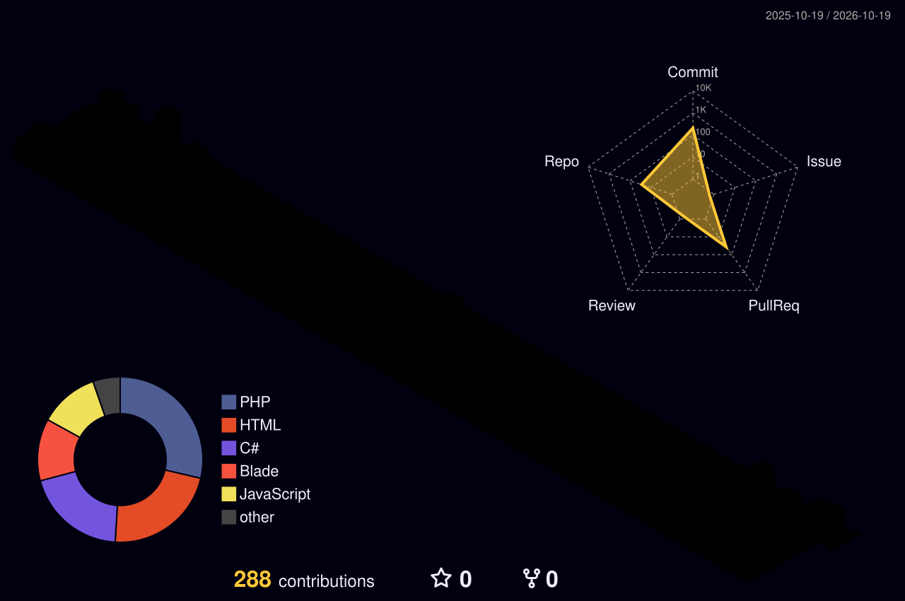

<!-- GitHub Profile README · theme: midnight blue -->

<!-- ===== HEADER ===== -->

  

  

  
  
  

 

<!-- ===== ABOUT ===== -->
<h2 align="center">About</h2>

  I enjoy turning ideas into working software — from web applications to desktop tools. 
  I care about clean code, thoughtful design, and learning something new every day.

|                      |                                                          |
| :------------------- | :------------------------------------------------------- |
| 🔭 **Currently**     | Building projects with PHP and C#                         |
| 🌱 **Learning**      | Laravel ecosystem · RESTful API · Clean Architecture      |
| 💡 **Interests**     | Web development · Desktop applications · UI design        |
| ⚡ **Workflow**       | Git · VS Code · Visual Studio                             |
| 📫 **Reach me**      | haidangblck@gmail.com                                     |

 

<!-- ===== TECH STACK ===== -->
<h2 align="center">Tech Stack</h2>

  
    
  

 

<!-- ===== PROJECTS ===== -->
<h2 align="center">Featured Projects</h2>

  
  
  
  

 

<!-- ===== STATS ===== -->
<h2 align="center">GitHub Stats</h2>

  
  

  

 

<!-- ===== 3D CONTRIBUTIONS ===== -->

  

<!-- ===== FOOTER ===== -->

  

